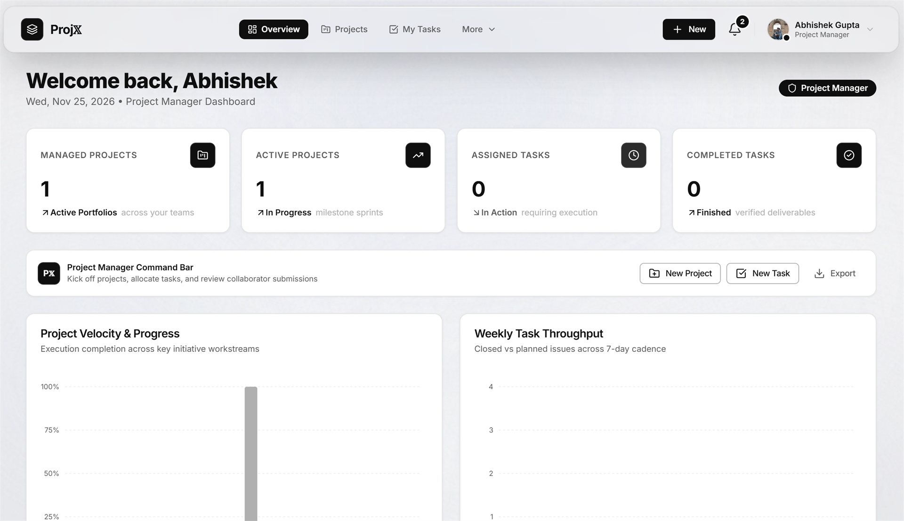
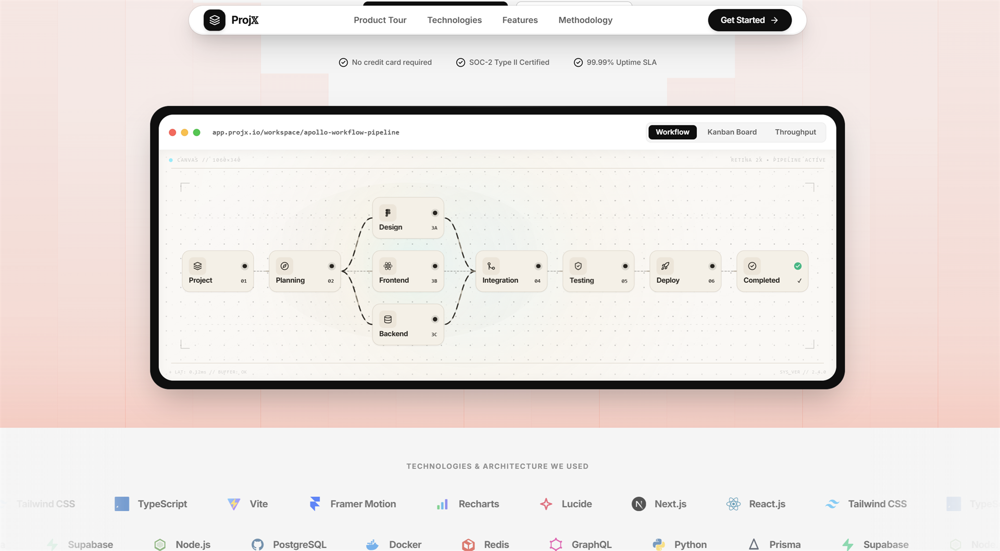
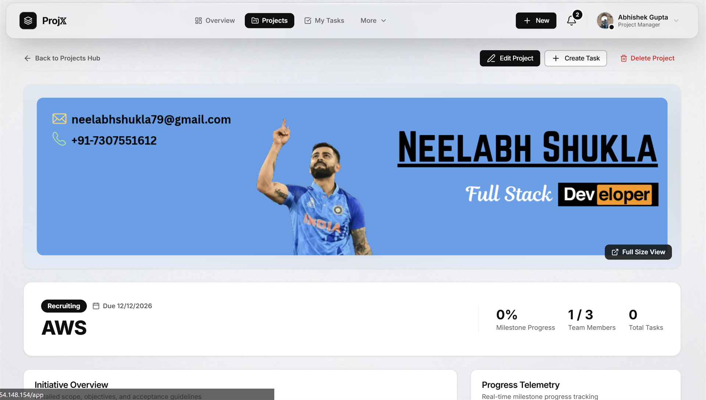
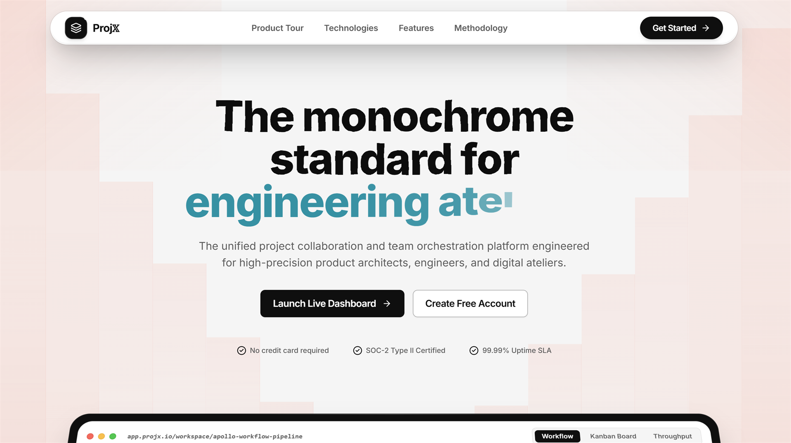
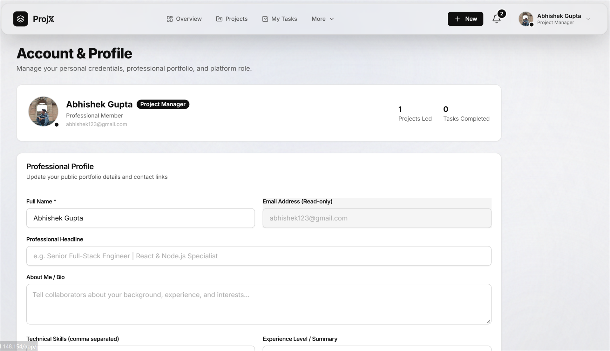
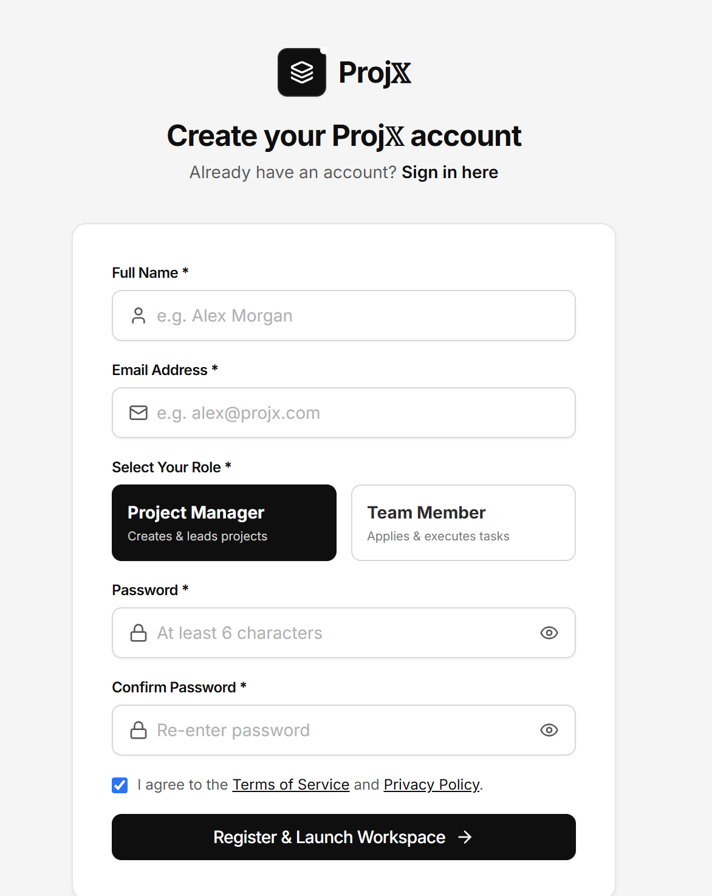
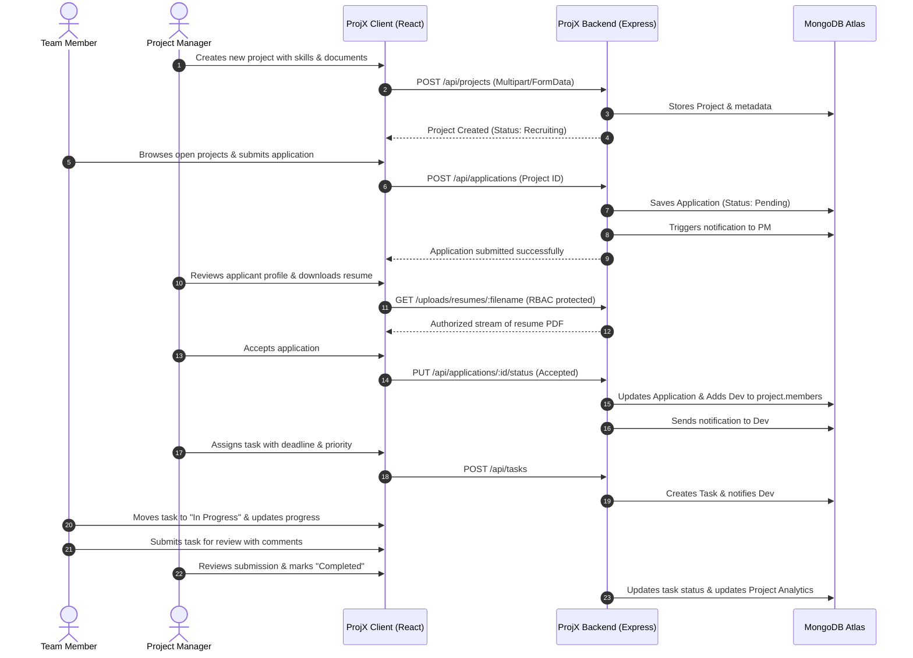
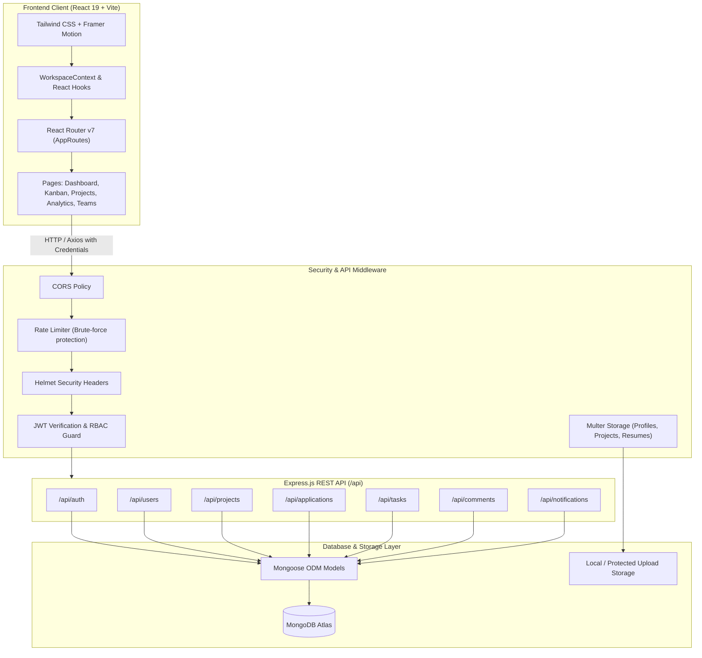

<div align="center">

# ProjX

### **Next-Gen Project Collaboration & Team Management Platform**

*Streamline project discovery, recruitment, sprint workflows, and real-time collaboration in one unified workspace.*

---

[](https://react.dev/)
[](https://vitejs.dev/)
[](https://tailwindcss.com/)
[](https://nodejs.org/)
[](https://expressjs.com/)
[](https://www.mongodb.com/)
[](LICENSE)

<br/>

[Key Features](#key-features) • [Showcase Gallery](#showcase-gallery) • [System Workflow](#system-workflow--architecture) • [Folder Structure](#folder-structure) • [Tech Stack](#tech-stack) • [Quick Start](#getting-started) • [API Reference](#api-endpoints)

---

</div>

<br/>

## Overview

**ProjX** is an end-to-end full-stack collaborative platform built to solve the modern challenge of team assembly and agile project execution. 

Unlike traditional project management boards, ProjX seamlessly connects **Project Managers** who need specific talent with **Team Members** looking for high-impact opportunities. From skill-matched project applications and resume vetting to interactive Kanban boards, sprint analytics, and real-time activity feeds, ProjX delivers a cohesive, friction-free productivity suite.

---

## Showcase Gallery

Visual side-by-side walkthrough of the ProjX collaborative workspace (click any preview to open full-resolution 1920px image):

<br/>

<table width="100%">
  <tr>
    <td width="50%" align="center" valign="top">
      <h4>Workspace Dashboard</h4>
      <a href="docs/images/dashboard.png" target="_blank">
        
      </a>
      <p><sub><em>Real-time project statistics, active sprints, recent tasks, and deadlines</em></sub></p>
    </td>
    <td width="50%" align="center" valign="top">
      <h4>Interactive Kanban Board</h4>
      <a href="docs/images/board.png" target="_blank">
        
      </a>
      <p><sub><em>Multi-stage sprint lifecycle, assignee indicators, priority tags, and stage filtering</em></sub></p>
    </td>
  </tr>
  <tr>
    <td width="50%" align="center" valign="top">
      <h4>Project Discovery & Catalog</h4>
      <a href="docs/images/Project.png" target="_blank">
        
      </a>
      <p><sub><em>Searchable directory of open initiatives with required skills and capacity quotas</em></sub></p>
    </td>
    <td width="50%" align="center" valign="top">
      <h4>Project Detail & Management Panel</h4>
      <a href="docs/images/Panel.png" target="_blank">
        
      </a>
      <p><sub><em>Detailed project overview, specifications, and applicant review & vetting</em></sub></p>
    </td>
  </tr>
  <tr>
    <td width="50%" align="center" valign="top">
      <h4>Member Profile & Skills Portfolio</h4>
      <a href="docs/images/Profile.png" target="_blank">
        
      </a>
      <p><sub><em>Technical skill set badges, experience details, and active project history</em></sub></p>
    </td>
    <td width="50%" align="center" valign="top">
      <h4>Authentication & Role Selection</h4>
      <a href="docs/images/Register.png" target="_blank">
        
      </a>
      <p><sub><em>Streamlined onboarding with explicit role-based access control (Manager vs Member)</em></sub></p>
    </td>
  </tr>
</table>

---

## Key Features

### Role-Based Access Control (RBAC)
- **Project Managers**: Author and configure projects, attach specification documents, review member applications (with resume access), invite members, assign tasks, and track team performance.
- **Team Members**: Discover active projects, apply with customized resumes, update task execution stages, contribute comments, and manage portfolio profiles.

### Project Discovery & Application Lifecycle
- Comprehensive project definitions (Skills required, Experience level, Deadlines, Document attachments, Capacity quotas).
- Multi-status project states: `Planning`, `Recruiting`, `In Progress`, and `Completed`.
- In-app application workflow (`Pending` -> `Accepted` / `Rejected`) with instant automated notifications.

### Agile Kanban Task Management
- Organized sprint columns: **To Do**, **In Progress**, **In Review**, and **Completed**.
- Priority level tags (`Low`, `Medium`, `High`) with due-date alerts.
- Dedicated modal view for task updates, status progression, and threaded discussion comments.

### Deep Analytics & Visual Intelligence
- Interactive Recharts widgets:
  - **Project Progress Chart**: Real-time completion percentages per active initiative.
  - **Task Completion Trends**: Weekly output vs. planned deliverables.
  - **Workload Balance**: Distribution of responsibilities across members.

### Contextual Notifications & Activity Feeds
- Automated triggers on task assignments, progress submissions, comment additions, and application status decisions.
- Dynamic global search for instant lookup across projects, tasks, and colleagues.

### Enterprise-Grade Security & File Storage
- **Authentication**: JWT authentication with HTTP-only cookies and Bearer token fallback.
- **Protected File Access**: Sensitive files (such as applicant resumes) are served via an authorized streaming route that verifies owner or manager relationship before dispatch.
- **API Hardening**: `helmet` headers, CORS whitelisting, and strict `express-rate-limit` protection on authentication routes.

---

## System Workflow & Architecture

### 1. End-to-End User & Project Workflow



<br/>

### 2. High-Level System Architecture



---

## Folder Structure

```
ProjX/
├── docs/
│   └── images/                        # Showcase screenshots (dashboard, board, Project, Panel, Profile, Register)
│       ├── raw/                       # Original captures
│       └── README.md                  # Image references and optimization guide
│
├── frontend/                          # Client application (React 19 + Vite)
│   ├── public/                        # Static assets (favicons, icons.svg)
│   ├── src/
│   │   ├── assets/                    # Brand assets & hero illustrations
│   │   ├── components/
│   │   │   ├── common/                # Reusable atomic UI (Button, Card, Modal, Input, Badge)
│   │   │   ├── dashboard/             # Metric cards, velocity charts, recent activity
│   │   │   ├── layout/                # Sidebar, TopNav, DashboardLayout, UserDropdown
│   │   │   ├── projects/              # ProjectCard, ProjectModal, ProjectDetailModal
│   │   │   ├── tasks/                 # TaskKanban, TaskCard, TaskDetailModal, TaskFilters
│   │   │   ├── teams/                 # TeamCard, TeamMemberList, InviteMemberModal
│   │   │   └── ui/                    # Animated components (ImageTrail, StackedLogos)
│   │   ├── context/                   # Global WorkspaceContext & state management
│   │   ├── hooks/                     # Custom React hooks
│   │   ├── lib/                       # Shared helper libraries & formatting
│   │   ├── pages/                     # Top-level view routes
│   │   │   ├── LandingPage.jsx        # Public showcase & marketing landing page
│   │   │   ├── LoginPage.jsx          # User authentication login
│   │   │   ├── RegisterPage.jsx       # Account creation & role selector
│   │   │   ├── DashboardPage.jsx      # Workspace overview & quick stats
│   │   │   ├── ProjectsPage.jsx       # Project catalog & recruitment board
│   │   │   ├── ProjectDetailPage.jsx  # In-depth project view & team roster
│   │   │   ├── TasksPage.jsx          # Interactive Kanban board & sprint backlog
│   │   │   ├── TeamsPage.jsx          # Directory of members & collaboration hub
│   │   │   ├── AnalyticsPage.jsx      # Recharts visualizations & metrics
│   │   │   ├── CalendarPage.jsx       # Milestone schedules & deadline calendar
│   │   │   ├── ActivityPage.jsx       # Granular chronological audit log
│   │   │   ├── ProfilePage.jsx        # Developer/Manager resume & portfolio
│   │   │   └── NotFoundPage.jsx       # 404 error page
│   │   ├── routes/                    # Central router definitions (AppRoutes.jsx)
│   │   ├── services/                  # Axios API service instances & interceptors
│   │   ├── utils/                     # Date formatters, validation, helpers
│   │   ├── App.jsx                    # Root app component with providers & Toaster
│   │   ├── index.css                  # Tailwind styles & theme variables
│   │   └── main.jsx                   # Vite React DOM entry point
│   ├── .env.example                   # Client environment template
│   ├── package.json                   # Frontend dependencies & scripts
│   ├── tailwind.config.js             # Tailwind CSS theme extension
│   └── vite.config.js                 # Vite bundler configuration
│
└── server/                            # Backend REST API (Node.js + Express)
    ├── config/                        # Database connection (db.js)
    ├── controllers/                   # Business logic handlers
    │   ├── applicationController.js   # Application lifecycle (Apply, Accept, Reject)
    │   ├── authController.js          # Authentication (Register, Login, Logout, Session)
    │   ├── commentController.js       # Task commentary & messaging
    │   ├── notificationController.js  # User notifications & read flags
    │   ├── projectController.js       # Project CRUD & recruitment status
    │   ├── taskController.js          # Task CRUD, status updates & assignments
    │   └── userController.js          # User profiles, skills & resume uploads
    ├── middleware/                    # Middleware pipeline
    │   ├── authMiddleware.js          # JWT verification & request hydration
    │   ├── errorMiddleware.js         # Centralized error handler & 404 catcher
    │   ├── roleMiddleware.js          # RBAC enforcement (isProjectManager, etc.)
    │   └── uploadMiddleware.js        # Multer disk configuration for files & resumes
    ├── models/                        # Mongoose Schema definitions
    │   ├── Application.js             # Project application records
    │   ├── Comment.js                 # Threaded task discussions
    │   ├── Notification.js            # In-app event alerts
    │   ├── Project.js                 # Project entity & team memberships
    │   ├── Task.js                    # Sprint tasks, statuses & priorities
    │   └── User.js                    # User accounts, roles, skills & resumes
    ├── routes/                        # Express REST route mounts
    │   ├── applicationRoutes.js       # /api/applications
    │   ├── authRoutes.js              # /api/auth
    │   ├── commentRoutes.js           # /api/comments
    │   ├── notificationRoutes.js      # /api/notifications
    │   ├── projectRoutes.js           # /api/projects
    │   ├── taskRoutes.js              # /api/tasks
    │   └── userRoutes.js              # /api/users
    ├── uploads/                       # Local storage directories
    │   ├── documents/                 # Project specification documents
    │   ├── profiles/                  # User avatar images
    │   ├── projects/                  # Project cover images
    │   └── resumes/                   # Protected applicant resume documents
    ├── utils/                         # Helper utilities (token generator)
    ├── .env.example                   # Backend environment template
    ├── package.json                   # Server dependencies & scripts
    └── server.js                      # Express server entry point & middleware bootstrap
```

---

## Tech Stack

| Domain | Technology | Description |
| :--- | :--- | :--- |
| **Frontend Core** | **React 19** | Latest concurrent features, optimized reconciliation |
| **Build Tool** | **Vite 8** | Instant Hot Module Replacement (HMR) and optimized rollup builds |
| **Styling & Design** | **Tailwind CSS 3.4** | Utility-first responsive design system with custom dark theme |
| **Icons & Motion** | **Lucide React + Framer Motion** | Crisp iconography and smooth UI micro-animations |
| **Data Visualization** | **Recharts 3** | Responsive SVG charts for sprint metrics and velocity |
| **Backend Framework** | **Node.js + Express 4.21** | Scalable, asynchronous REST API service |
| **Database & ODM** | **MongoDB + Mongoose 8.9** | Flexible document store with schema validation and indexing |
| **Security & Auth** | **JWT + Helmet + RateLimit** | Cookie/Bearer authentication, brute-force defense, HTTP security |
| **File Handling** | **Multer** | Multipart form processing with custom disk storage and RBAC streaming |

---

## Getting Started

Follow the steps below to run both the backend server and frontend client locally.

### Prerequisites
- **Node.js** v18.0.0 or higher
- **npm** v9+ (or **pnpm** / **yarn**)
- **MongoDB** instance (Local running daemon or free MongoDB Atlas cluster)

---

### 1. Clone the Repository

```bash
git clone https://github.com/your-username/ProjX.git
cd ProjX
```

---

### 2. Configure Environment Variables

#### Backend Configuration (`server/.env`)
Create `server/.env` by copying the sample:

```bash
# In directory: server/
cp .env.example .env
```

Edit `server/.env` with your values:

```env
PORT=5000
NODE_ENV=development
MONGODB_URI=mongodb://127.0.0.1:27017/projx
JWT_SECRET=your_super_secret_jwt_key_here_change_in_production
JWT_EXPIRES_IN=7d
CLIENT_URL=http://localhost:5173
COOKIE_NAME=projx_token
```

#### Frontend Configuration (`frontend/.env`)
Create `frontend/.env` by copying the sample:

```bash
# In directory: frontend/
cp .env.example .env
```

Configure `frontend/.env`:

```env
VITE_API_BASE_URL=http://localhost:5000/api
VITE_API_ORIGIN=http://localhost:5000
```

---

### 3. Install & Start Backend

Open a terminal session:

```bash
cd server
npm install
npm run dev
```

*The API will start at:* **`http://localhost:5000`** *(Healthcheck: `http://localhost:5000/api/health`)*

---

### 4. Install & Start Frontend

Open a second terminal session:

```bash
cd frontend
npm install
npm run dev
```

*The web application will launch at:* **`http://localhost:5173`**

---

## API Endpoints

All application routes are prefixed with `/api`. Protected routes require a valid JWT token via an HTTP-only cookie or `Authorization: Bearer <token>` header.

### Authentication (`/api/auth`)
| Method | Route | Access | Description |
| :--- | :--- | :--- | :--- |
| `POST` | `/api/auth/register` | Public | Register new user as `project_manager` or `team_member` |
| `POST` | `/api/auth/login` | Public | Authenticate user & issue JWT |
| `POST` | `/api/auth/logout` | Authenticated | Invalidate auth cookie |
| `GET` | `/api/auth/me` | Authenticated | Fetch current authenticated user profile |

### Projects (`/api/projects`)
| Method | Route | Access | Description |
| :--- | :--- | :--- | :--- |
| `GET` | `/api/projects` | Authenticated | List all active/recruiting projects with filters |
| `POST` | `/api/projects` | **Manager Only** | Create project with cover image & spec documents |
| `GET` | `/api/projects/my-projects`| Authenticated | Get projects owned by or assigned to the current user |
| `GET` | `/api/projects/:id` | Authenticated | Retrieve complete project details and member roster |
| `PUT` | `/api/projects/:id` | **Manager Only** | Update project settings, deadline, or required skills |
| `DELETE`| `/api/projects/:id` | **Manager Only** | Delete project and associated records |

### Applications (`/api/applications`)
| Method | Route | Access | Description |
| :--- | :--- | :--- | :--- |
| `POST` | `/api/applications` | **Member Only** | Apply to an open project |
| `GET` | `/api/applications/my-applications` | **Member Only** | View status of submitted applications |
| `GET` | `/api/applications/project/:projectId` | **Manager Only** | Review applicants for a managed project |
| `PUT` | `/api/applications/:id/status` | **Manager Only** | Accept or Reject application |

### Tasks (`/api/tasks`)
| Method | Route | Access | Description |
| :--- | :--- | :--- | :--- |
| `GET` | `/api/tasks` | Authenticated | List tasks filtered by project, status, or assignee |
| `POST` | `/api/tasks` | **Manager Only** | Create and assign a task with due date & priority |
| `GET` | `/api/tasks/:id` | Authenticated | Fetch specific task with comment thread |
| `PUT` | `/api/tasks/:id` | Authenticated | Update task stage (`To Do` -> `In Progress` -> `In Review` -> `Completed`) |
| `DELETE`| `/api/tasks/:id` | **Manager Only** | Remove task |

### Comments & Notifications
| Method | Route | Access | Description |
| :--- | :--- | :--- | :--- |
| `POST` | `/api/comments` | Authenticated | Post comment on a task thread |
| `GET` | `/api/comments/task/:taskId` | Authenticated | Retrieve task comments |
| `GET` | `/api/notifications` | Authenticated | Get user notifications |
| `PUT` | `/api/notifications/:id/read`| Authenticated | Mark notification as read |

### Protected Media Access
| Method | Route | Access | Description |
| :--- | :--- | :--- | :--- |
| `GET` | `/uploads/resumes/:filename` | **Authorized Only** | Stream resume PDF (Restricted to resume owner or evaluating PM) |

---

## Role Permissions Matrix

| Capability | Project Manager | Team Member | Guest |
| :--- | :---: | :---: | :---: |
| Browse Projects & Public Profiles | Yes | Yes | Yes |
| Apply to Projects with Resume | No | Yes | No |
| Create New Projects & Upload Docs | Yes | No | No |
| Accept / Reject Project Applicants | Yes | No | No |
| View Applicant Resumes | Yes (Evaluating PM) | Yes (Self Only) | No |
| Create & Assign Tasks | Yes | No | No |
| Update Task Progress & Status | Yes | Yes (Assigned) | No |
| Post Comments & Participate in Threads | Yes | Yes | No |
| Access Workspace Analytics & Velocity | Yes | Yes | No |

---

## Available Scripts

### In `/server`
- `npm run dev`: Starts Express server with live reload via `nodemon`
- `npm start`: Runs the server in production mode with standard `node`

### In `/frontend`
- `npm run dev`: Starts the Vite local development server with HMR
- `npm run build`: Bundles production assets into `dist/`
- `npm run lint`: Fast linting using `oxlint`
- `npm run preview`: Previews the production build locally

---

## Contributing

Contributions make the open-source community an inspiring place to learn, inspire, and create. Any contributions you make are **greatly appreciated**.

1. Fork the Project
2. Create your Feature Branch (`git checkout -b feature/AmazingFeature`)
3. Commit your Changes (`git commit -m 'feat: Add AmazingFeature'`)
4. Push to the Branch (`git push origin feature/AmazingFeature`)
5. Open a Pull Request

---

## License

Distributed under the **MIT License**. See `LICENSE` for more information.

<div align="center">
  <sub>Built for high-performance engineering teams.</sub>
</div>
